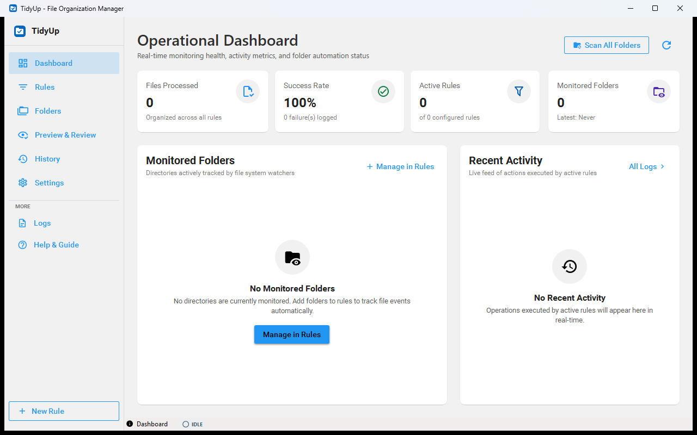

<p align="center"></p>

# TidyUp

[](https://github.com/dazzo31/Tidy-up/actions/workflows/ci.yml)
[](https://dotnet.microsoft.com/)
[](LICENSE)
[](https://github.com/sponsors/dazzo31)
[](https://buymeacoffee.com/dazzo31)

**TidyUp** is a high-performance, hardened automated file organization tool for Windows. It provides intelligent rule-based sorting, active folder monitoring, duplicate detection, and automated cleanup with an uncompromising focus on **data safety, predictability, and reversibility**.



Every destination is captured in both themes under [`docs/screenshots/`](docs/screenshots); regenerate them with `scripts/Capture-Screenshots.ps1`.

---

## Key Features

- 🖥️ **Modern Windows 11 User Experience:** Persistent left navigation rail across 6 core destinations (Dashboard, Rules, Folders, Preview & Review, History, Settings) plus a "More" group for Logs and Help, with accessible focus and keyboard shortcuts (`Ctrl+1` through `Ctrl+6`).
- 🪄 **4-Stage Guided Rule Wizard:** Seamless step-by-step rule creation (Folders, Conditions, Actions, Review) with lossless synchronization to advanced tabbed editing.
- 📁 **Dedicated Folders Management Hub:** Centralized monitored folders workspace with real-time directory permission auditing (`Read/Write`, `Read Only`, `Access Denied`), system-protected path detection, and exclusion patterns (`.git`, `node_modules`).
- 👁️ **Full-Page Preview & Review Workspace:** First-class dry-run simulation workspace with operation breakdown counters, virtualized DataGrid, side-by-side impact review, and cooperative in-flight batch cancellation.
- 💡 **Explainability Inspector:** "Why Did This File Match?" inspection drawer evaluating and displaying condition-by-condition pass/fail evaluation breakdowns.
- 🛡️ **Zero-Loss Safety Model & Two-Step Apply:** Deletions route to the Windows Shell Recycle Bin by default. Two-step guarded Apply workflow verifies file existence and re-checks for disk mutations before applying changes.
- ⏪ **1-Click Rollback Engine & Actionable History:** Full historical SQLite journaling tracks every operation with SHA-256 hashes, user-actionable error explanations, technical diagnostic drawers, and anti-clobbering pre-rollback verification.
- ⚡ **Hardened File Watcher & Health Monitoring:** Bounded 64KB buffers, multi-event debouncing (500ms), real-time status bar health badge, and automated degraded state recovery.
- ⚙️ **Categorized 5-Section Settings:** Structured preferences across General, Safety, Performance, Storage & Logs, and Advanced sections with contextual risk explanations and database VACUUM optimization.
- 🔍 **Hash-Based Duplicate Detector:** High-speed 3-step duplicate detection (file-size bucketing $\rightarrow$ 4KB partial hash $\rightarrow$ full SHA-256 verification) with automated isolation into `_Duplicates`.
- 🌙 **Scheduled Execution & Quiet Hours:** Schedule background jobs by time of day, configure quiet hours (e.g. 22:00–06:00), and automatically throttle when running on battery ($\le 20\%$).
- 📄 **Deep Content & Metadata Inspection:** Match files by plain text/regex keywords (safe streaming up to 1MB), image EXIF metadata (dimensions, Date Taken, camera model), and audio/video tags (MP3 ID3, WAV duration).
- 📜 **Versioned Rule History & Diff:** Track rule edits, view side-by-side visual diffs, and restore previous rule versions with one click.
- 📦 **Safe Rule Sharing & Templates:** Import/export rule packages with JSON schema validation (`https://tidyup.app/schemas/rules-v1.json`), path sanitization against reserved Windows device names, and safe disabled-by-default import.
- 🗄️ **Database Disaster Recovery:** Automatic pre-migration and daily SQLite backups, startup `PRAGMA integrity_check`, and instant rollback on corruption.

---

## Safety Invariants

TidyUp is engineered with non-negotiable architectural safeguards:

1. **Recycle Bin Authority:** Files are sent to the Windows Shell Recycle Bin. Permanent deletion is rejected on volumes that do not support the Recycle Bin unless explicitly authorized.
2. **File Lock Safety:** Files currently open by other applications (such as incomplete browser downloads or ongoing large copies) are detected and delayed via exponential backoff until released.
3. **Pre-Execution Checksumming:** Original source files are verified with SHA-256 before disk writes and re-verified post-execution.
4. **Execution Choke Point:** All operations funnel through an audited pipeline (`BatchProcessingCoordinator` $\rightarrow$ `ActionExecutor` $\rightarrow$ `OperationJournal`).
5. **Pre-Migration Backups:** SQLite database schema upgrades always take an automated backup first; failures trigger automatic restoration to the pre-migration state.

---

## System Requirements

- **Operating System:** Windows 10 (Build 19041+) or Windows 11 (x64, ARM64)
- **Runtime:** [.NET 9.0 Desktop Runtime](https://dotnet.microsoft.com/download/dotnet/9.0) (Windows Desktop pack)

---

## Getting Started

### 1. Prerequisites
Ensure the [.NET 9 SDK](https://dotnet.microsoft.com/download/dotnet/9.0) is installed:
```powershell
dotnet --version
```

### 2. Clone the Repository
```powershell
git clone https://github.com/dazzo31/Tidy-up.git
cd Tidy-up
```

### 3. Build & Run
```powershell
# Restore NuGet dependencies
dotnet restore

# Build in Release configuration
dotnet build -c Release

# Run the WPF application
dotnet run --project TidyUp -c Release
```

### 4. Run the Test Suite
The solution contains 426 comprehensive unit and integration tests:
```powershell
dotnet test -c Release --verbosity normal
```

---

## Documentation

- 🏛️ [Architecture & Technical Design](docs/ARCHITECTURE.md) - Subsystem details, sequence diagrams, and design principles.
- 📋 [Feature Verification Matrix](docs/FEATURE_MATRIX.md) - Authoritative verification status and test coverage for all requirements.
- 📑 [Task Catalog](TASK_CATALOG.md) - Work breakdown structure, task specifications, and governance log.
- 📜 [Specifications](docs/spec/) - Original architectural plan and GUI design specifications.
- 🛠️ [Helper Scripts](scripts/) - Standalone utilities for Google Takeout photo organization.
- 📂 [Historical Archive](docs/historical/) - Pre-v1.0 milestone logs and session notes.

---

## 💖 Support & Sponsorship

If TidyUp has helped organize your files, saved you time, or streamlined your cleanup workflows, consider supporting ongoing development:

[](https://github.com/sponsors/dazzo31)
[](https://buymeacoffee.com/dazzo31)

---

## License

This project is licensed under the MIT License. See [LICENSE](LICENSE) for details.