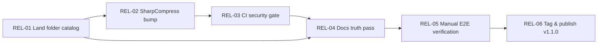

# TidyUp: v1.1.0 Release Implementation Plan

**Status:** DRAFT — ready for execution
**Baseline date:** 2026-10-15
**Baseline state:** `main` == `v1.0.0-beta.1` (cd6bbf3) + uncommitted folder-catalog feature; 426/426 tests passing; 1 NuGet vulnerability warning (SharpCompress 0.41.0).

---

## 0. Current Situation (verified 2026-10-15)

| Fact | Evidence |
| :--- | :--- |
| All catalog tasks marked COMPLETE | `TASK_CATALOG.md` (TASK-UI-15 is the last, marked COMPLETE) |
| Tests green | `dotnet test` Release: 426 passed, 0 failed |
| One vulnerable dependency | `SharpCompress 0.41.0` → NU1902 (GHSA-6c8g-7p36-r338, moderate) |
| Beta tag exists | `v1.0.0-beta.1` at cd6bbf3 |
| Uncommitted feature in flight | `IMonitoredFolderCatalog` / `FolderPathNormalizer` / `FolderValidator` wired through DI into `DashboardViewModel`, `FoldersViewModel`, `MainWindowViewModel`, `RuleWizardViewModel`, `RuleRepository`; +481/-98 lines, plus 2 new test classes |
| Docs current | README, `docs/FEATURE_MATRIX.md`, `CHANGELOG.md` (1.0.0 + 1.1.0 entries written) |

The codebase is feature-complete per the catalog. What remains is **release hardening**: commit the in-flight work as a proper task, burn down the dependency warning, add a security gate to CI, run a manual end-to-end verification, and ship.

---

## 1. Guiding Constraints

These come from `TASK_CATALOG.md` governance and the repo's conventions:

1. **One task, one commit** — no out-of-scope refactoring piggy-backed on fixes.
2. **Safety invariant** — no file operation without pre-flight validation; previews stay read-only; deletes go to the Recycle Bin by default.
3. **Testing invariant** — file operations tested against real temp filesystem structures, never mocks that hide locking/permission behavior.
4. **Conventional commits** — recent history uses `feat(scope):`, `fix(scope):`, `docs:` prefixes; match it.
5. **Docs stay truthful** — every claim in README/FEATURE_MATRIX must be backed by a test or manual verification evidence before tagging.

---

## 2. Work Item Breakdown

### REL-01 — Land the in-flight folder-catalog feature

**Objective:** Commit the uncommitted `MonitoredFolderCatalog` work as a coherent, tested change before any release activity.

**Scope:**
- Review the 8 modified files + 4 untracked paths (`TidyUp/Models/Folders/`, `TidyUp/Services/Folders/`, two new test classes) as one feature.
- Decide whether `.github/FUNDING.yml` and `publish/` belong in this commit (funding: probably its own `docs:` commit; `publish/`: verify it's gitignored build output and NOT committed — it contains release binaries, `TidyUp.deps.json` etc.).
- Confirm behavior claims: catalog is the single source of truth for monitored folders; normalizer handles trailing slashes/casing/UNC; dashboard/folders views sync from `CatalogChanged`.
- Run new tests: `dotnet test --filter "FullyQualifiedName~FolderPathNormalizerTests|FullyQualifiedName~MonitoredFolderCatalogTests"`.
- Run full suite: `dotnet test TidyUp.sln -c Release`.

**Out of scope:** any monitoring-engine changes, UI redesign, touching unrelated view models.

**Done when:**
- `git status` clean except intentionally excluded paths; `publish/` untracked-and-ignored or removed from the index.
- New tests pass; full suite still 426+ green.
- Committed as e.g. `feat(folders): shared monitored-folder catalog with path normalization`.

---

### REL-02 — Eliminate the SharpCompress vulnerability warning

**Objective:** Zero known-vulnerability warnings in build output.

**Scope:**
- Bump `SharpCompress` in `TidyUp/TidyUp.csproj` to the lowest version fixing GHSA-6c8g-7p36-r338 (check NuGet: ≥ 0.42.0 or current stable; verify the advisory's patched range first).
- `dotnet restore` + `dotnet build -c Release`: NU1902 must be gone.
- Verify archive extraction still works: run `ExtractArchiveAction`-related tests (`dotnet test --filter "FullyQualifiedName~Archive"`); add real-filesystem archive round-trip coverage if the bump changes behavior (SharpCompress 0.42+ had API/behavior changes in archive writing).
- Also check `TidyUp.Tests.csproj` for the transitive reference.

**Out of scope:** upgrading other packages; replacing the archive library.

**Done when:**
- `dotnet list package --vulnerable` reports zero.
- Archive tests pass on real temp files; no NU1902/NU1903 in build log.
- Committed as `fix(deps): bump SharpCompress to <version> (GHSA-6c8g-7p36-r338)`.

---

### REL-03 — Add dependency-security gate to CI

**Objective:** Close the gap between the catalog ("runs dependency/security checks on every pull request") and `ci.yml` (currently build+test+coverage only).

**Scope:**
- Add to `.github/workflows/ci.yml`:
  - `dotnet list package --vulnerable --include-transitive` as a step, failing the job on any non-zero vulnerability output (use `--format json` and a small PowerShell assertion, or the documented exit-code approach).
  - Consider `dotnet list package --deprecated` as warning-only.
- Optionally enable Dependabot (`.github/dependabot.yml`, weekly NuGet + GitHub Actions updates).
- Consider adding `windows-2022` to the matrix if `windows-latest` drift matters; keep it minimal.

**Out of scope:** packaging/deployment jobs; signing; store upload.

**Done when:**
- CI fails when a vulnerable package is introduced (validate by the REL-02 history: would have flagged 0.41.0).
- CI green on main.
- Committed as `ci: add vulnerability gate to build workflow` (+ optional `ci: add dependabot config`).

---

### REL-04 — Documentation truth pass

**Objective:** Every public claim is verifiable; stale audit docs are clearly historical.

**Scope:**
- `docs/baseline_defects.md` and `docs/ui_inventory.md` describe the Oct 9 baseline (pre-Phase-1-6). Add a header banner: "Historical baseline — defects resolved in v1.0/v1.1; see `docs/FEATURE_MATRIX.md` for current status." Prevents exactly the misreading that originally caused "100% complete" confusion.
- Reconcile `TASK_CATALOG.md` with reality: it says `TASK-DOC-03` "GitHub Actions CI ... dependency/security checks" is COMPLETE; either implement (REL-03) — preferred — or correct the status. Note: heading says TASK-DOC-03 but body says TASK-CI-01; fix the ID inconsistency while touching it.
- `CHANGELOG.md`: add the REL-01/02/03 changes under `[1.1.0]`.
- `docs/baseline_test_report.md`: refresh numbers (426 tests) or link to latest CI artifact.
- README: verify the stated test count ("410+") still matches; bump if REL-01 added tests.

**Done when:**
- No document contradicts another on completion status.
- Committed as `docs: mark baseline audits historical and sync release docs`.

---

### REL-05 — Manual end-to-end verification (release gate)

**Objective:** Human-verified evidence that the safety-critical paths work against the real filesystem — the automated suite doesn't cover watcher timing, tray behavior, or Recycle Bin routing end-to-end.

**Checklist (run from a Release or publish build, not the IDE):**

1. **Folder monitoring (was DEF-P0-03)**
   - Add a test folder with a rule; confirm `FileMonitorService` starts on launch, tray shows Running, dropping files in triggers processing; Pause/Resume from tray works.
2. **Delete safety (was DEF-P0-01)**
   - Delete action lands files in the Recycle Bin (verify in Explorer); overwrite-conflict move never destroys the destination when the move fails.
3. **Preview honesty (was DEF-P1-01)**
   - Preview → Review → Two-step apply; preview is read-only (file timestamps/hashes unchanged after simulation).
4. **Rollback (was DEF-P0-06)**
   - Execute a batch, then roll it back from History; confirm SHA-256 pre-check refuses rollback when target was externally modified.
5. **Watcher resilience (was DEF-P0-04)**
   - Burst test: drop ~500 files quickly; confirm the overflow reconciler recovers and the health badge reports degraded→recovered.
6. **Tray & state (was DEF-P0-03 tray stubs)**
   - Minimize to tray, quiet hours, battery throttle (simulated), notifications fire.
7. **Empty-folder loop guard (was DEF-P0-02)**
   - RemoveEmptyFolders never climbs above the monitored root.
8. **First-run & onboarding** — fresh profile path shows wizard exactly once.
9. **Accessibility spot check** — keyboard-only pass over the 6 nav destinations; screen reader names on icon buttons.

**Evidence:** record results (pass/fail + build hash) in `docs/release-verification-1.1.0.md` in the same style as existing docs. Any FAIL becomes a new P0 defect and blocks tagging.

---

### REL-06 — Verify & ship v1.1.0

**Objective:** Tag and publish only after REL-01–05 are green.

**Scope:**
1. Confirm `git status` clean, CI green on the exact commit to be tagged.
2. Tag: `git tag -a v1.1.0 -m "v1.1.0 — Phase 6 UI/UX modernization + folder catalog hardening"` and `git push origin main --tags`.
3. Refresh the publish artifact: `dotnet publish TidyUp/TidyUp.csproj -c Release -r win-x64 --self-contained` (match the existing `publish/TidyUp-win-x64` layout); smoke-run the published exe.
4. Create the GitHub Release from `CHANGELOG.md` `[1.1.0]`, attach the publish zip.
5. Optional follow-ups (post-release, separate PRs): consider `v1.0.0-beta.1` cleanup, Windows signing/SmartScreen story, Store/Chocolatey packaging (explicitly out of CI scope today).

**Done when:**
- Tag pushed, release published, published binary launches and passes item 1–3 of the REL-05 checklist.

---

## 3. Dependency Order

REL-02 does not strictly depend on REL-01's code, but landing the big uncommitted diff first avoids rebase churn in `ServiceConfiguration.cs`.

---

## 4. Risk Register

| Risk | Mitigation |
| :--- | :--- |
| SharpCompress bump breaks archive extraction subtly | Run archive tests against real temp files; inspect `ExtractArchiveAction` code path for API changes before committing. |
| Folder-catalog feature has hidden integration bugs | It was authored without a task contract; REL-01 review treats it as a PR — reviewer pass before full suite. |
| Manual verification finds a P0 | Block tag; file defect entry in a new `docs/` report; fix as `fix(...)` commit, re-run REL-05 item. |
| `publish/` binaries pollute the repo | Confirm ignore rule; never commit binaries; publish artifacts attach to the GitHub Release instead. |
| Fluent Assertions license warning in tests | Non-blocking (test-only, non-commercial is free), but note it in release docs if commercial use is ever intended. |

---

## 5. Definition of Done (release level)

- [ ] `git status` clean; in-flight work committed with conventional messages
- [ ] `dotnet build -c Release`: 0 warnings of severity NU190x
- [ ] `dotnet test -c Release`: all green (currently 426)
- [ ] CI includes and passes the vulnerability gate
- [ ] No doc contradicts another; FEATURE_MATRIX claims all have evidence
- [ ] `docs/release-verification-1.1.0.md` records manual E2E results
- [ ] `v1.1.0` tagged and GitHub Release published with tested binary
