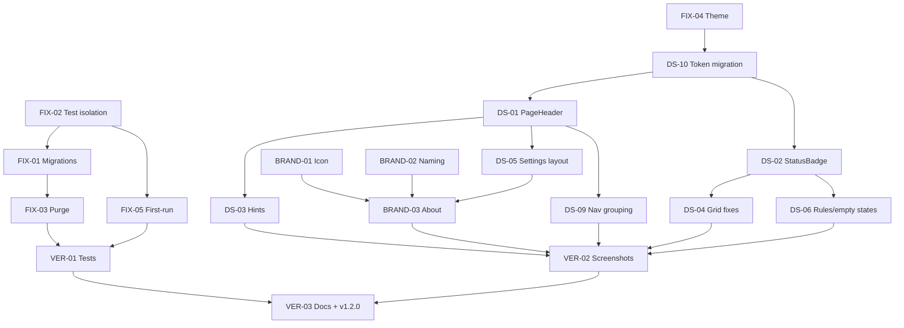

# TidyUp Phase 7 — UI/UX & Correctness Remediation: Detailed Implementation Plan

**Plan date:** 2026-10-16
**Baseline:** `main` @ `7edc929` (tagged `v1.1.0` / `v1.1.0-beta.1`), 426 tests, 0 build warnings, 0 vulnerable packages
**Reviewed artifact:** `publish/TidyUp-win-x64/TidyUp.exe` (self-contained), screenshots of all 6 nav destinations + Logs
**Target release:** `v1.2.0`
**Governance:** Follows `TASK_CATALOG.md` Task Lock Protocol — one task, one commit, IN SCOPE only, verify every DONE WHEN before reporting complete.

---

## 0. Executive Summary

The v1.1.0 GUI exposes **four correctness bugs disguised as design problems**, **three branding gaps**, and **ten design-system inconsistencies**. The two most serious:

1. **Test data leaks into the user's production database.** Five test classes call `ServiceConfiguration.ConfigureServices()`, which hard-codes `%APPDATA%\TidyUp\tidyup.db`. Result: 5 duplicate "Organize PDFs" rules pointing at `%TEMP%\TidyUp_UiIntegration_*` folders appear in the real app.
2. **Rollback/History is broken for every user who upgraded.** Startup uses `EnsureCreatedAsync()`, which never alters an existing schema. The `OperationJournal` table is missing → `SQLite Error 1: no such table`. No EF migrations exist despite `TASK-ADV-07` being marked COMPLETE.

Everything else (theme not applied, first-run wizard dead, "X" icon, inconsistent headers/badges/hints) is real but secondary.

**Scope:** 17 tasks across 4 phases. Phase 7A (data integrity) is a hard prerequisite; 7B (brand) and 7C (design system) parallelize; 7D ships `v1.2.0`.

---

## 0a. Execution Log & Plan Corrections (Phase 7A complete; DS-10, BRAND-01, BRAND-02 done)

Status: **FIX-01..FIX-05 done** (commits `3b7f839`, `d08861a`, `cc0998c`, `22ac5b1`, `0686e05`); **DS-10 done** (`d6f8145`); **BRAND-02 done** (`9af9391`); **BRAND-01 done**. Remaining: BRAND-03, VER-*. **DS-01..DS-09 done.**

### Corrections to this plan found during execution

| Plan said | What verification showed |
| :-- | :-- |
| **F-02:** five `ConfigureServices()` test classes leaked the "Organize PDFs" rules. | Those classes never persisted that rule. The 5 rules were created 2026-10-10 23:21 → 2026-10-11 07:15 by an **early iteration** of `UiWorkflowEndToEndIntegrationTests` (later fixed to use its own DB). The structural hazard was real (they resolved the live path and one executed `SaveRuleCommand`), so FIX-02 stands, but it was prevention, not the cause. |
| **FIX-02:** `ProductionDataGuard` comparing mtimes. | Replaced by (a) a module initializer redirecting `TIDYUP_APPDATA` to temp for the whole test process and (b) `TestIsolationGuardTests`, a source scan that fails on `ConfigureServices()` / `TidyUpPaths.Default(` / `SpecialFolder.ApplicationData` in tests. mtime comparison is flaky while a dev has the app open. Verified with a planted violation. |
| **ADV-07 is only missing migrations.** | `IDatabaseBackupManager`, `IDbIntegrityChecker` were **never registered in DI** (Settings' manual-backup button always said "Backup manager not available"). |
| **FIX-01:** split migrations, baseline detection. | Done as specified, plus: legacy DDL verified identical to a real production DB; baseline refuses if a legacy column is missing; backup only when a migration is pending (the existing checker backed up on **every launch**). |
| *(not in plan)* | Backup hardening: the DB is WAL-mode and a plain file copy misses un-checkpointed commits (now SQLite online backup); pruning counted all backup kinds together and would evict manual/daily backups (now per kind; manual never pruned); restore left stale `-wal`/`-shm`. |
| **FIX-03:** committed purge script. | Rescoped. A machine-specific cleanup is not repo content. Shipped the reusable part (`TransientLocations` + a Temp-folder warning in Folders) and ran a one-off, approved, backed-up purge locally. |
| **FIX-04:** `Theme` becomes an enum; rename `Colors.xaml`. | Kept `Theme` a **string** (an enum parse failure makes `LoadAsync` silently reset *all* settings) and kept `Colors.xaml`, adding `Colors.Dark.xaml` as an overlay. Added a `SchemaVersion` migration: every existing file holds `Theme=Dark` only because that was the old default, so it migrates to `System` instead of flipping upgraders to dark. |
| *(not in plan)* | **Pre-existing persistence bug:** Settings saved its own `AppSettings` copy while the main window re-saved a stale startup copy on close, reverting every Settings change. Fixed with one shared instance (`SettingsRepository.LoadSharedAsync`). |
| *(not in plan)* | Tray **Exit** set `MinimizeToTray=false` and the close handler persisted it, silently disabling the setting for good. Now a transient flag. |
| *(not in plan)* | Light `warning` token claimed AA but measured 4.20:1; `#D83B01` → `#CC3600`. Both palettes are now contrast-checked from the XAML (`ThemePaletteTests`). |
| **FIX-05:** show the wizard once. | Also fixed: Skip was bound to `FinishCommand`; "show again" mirrored the flag so Finish re-showed it every launch; the window never got its `DataContext`; the sample rule duplicated on re-run; and the wizard being the only window would end the app on close (`ShutdownMode`). Re-entry lives in Settings → General. |
| **DS-10:** replace literal colours with tokens. | 175 XAML + C# literals removed (0 remain). View-model badge properties used to return hex strings (a one-shot binding that cannot follow a theme switch); they now return **token keys** and XAML binds them with `styles:ThemeBrush.Background/Foreground` (`SetResourceReference`), so badges re-resolve live. Solid fills use `Win11*SolidBrush` + `Win11OnSolidBrush` (white text verified AA); tints use `Win11*BackgroundBrush`. `StyleGuardTests` now fails the build if a literal colour is reintroduced under Views/, Controls/, MainWindow.xaml, ViewModels/ or Models/. All 43 referenced `Win11*` keys exist in both palettes (scripted check). |
| *(not in plan)* | `publish/` was not git-ignored; a blanket `git add -A` staged 139 build artefacts. Caught before pushing, amended out of the local commit, `/publish/` added to `.gitignore`. |
| **BRAND-01:** `TidyUpLogo.xaml` as a `DrawingImage`; mono-dark/mono-light SVGs. | Built the in-app logo as a small `TidyUpLogo` **control** (Viewbox + shapes bound to `Win11AccentBrush`/`Win11SurfaceBrush`): `DynamicResource` inside a `Freezable` drawing is unreliable for live theme switching, shapes in a `FrameworkElement` are not. The two mono SVGs were dropped: nothing consumes them (the tray icon is drawn by `TrayIconService` as a status dot). The old `tidyup.ico` was a single 128 px image; the new one has 9 sizes (16–256, PNG-compressed, alpha) generated by `scripts/Build-Icon.ps1` using only System.Drawing (no ImageMagick dependency). `ApplicationIcon` was also missing, so Explorer showed the default icon for `TidyUp.exe`; now embedded. `BrandAssetTests` assert header count ≥ 6, the sizes Windows requests, 32-bit depth and the csproj wiring. Looks verified by pixel sampling (tile/folder/check/transparent corner at every size), not by eye. |
| **BRAND-02:** metadata. | Done as specified (Product/Title/Company/Copyright/Version 1.2.0); the exe now reports `1.2.0+<commit>`. Only two `Tidy-up` strings existed in sources (Settings). |
| *(observed)* | `RuleWizardViewModel_ToggleRuleEnabled_UpdatesEnabledSeparatelyFromSave` failed once right after a build and passed in 15 further runs; not reproducible, root cause unknown. Watch for it. |
| **DS-01:** `PageHeader` on every page; titles 28 px. | Done for Dashboard, Folders, Preview, History, Logs, Settings (the Rules region lives in `MainWindow` and is handled with DS-06). Titles now follow the nav names (`Monitored Folders Hub` \u2192 `Monitored Folders`, `Application Settings` \u2192 `Settings`, `Preview & Review Workspace` \u2192 `Preview & Review`) and all pages use 24 px padding (they were 0/16/24). History and Logs had no header at all. Verified at runtime with UI Automation in Light and Dark: every title is at the same window offset (x=252, y=55, h=36) and each page's action button renders in the slot. `PageHeaderTests` fail if a page goes back to a Headline style. **Found while verifying:** the Dashboard/History header buttons had no accessible name (icon + text in a panel); named. |\n| **DS-02:** `StatusBadge`, 6-value `FolderStatus`. | Dashboard showed watcher health (`Healthy`/`Disconnected`) and Folders showed path checks (`Accessible`/`Restricted`/`Protected System Path`), so one folder could read differently on each screen, and a missing folder showed `Disconnected` on one and `Missing` on the other. Now `FolderStatusResolver.Resolve(validation, watcher, isSystemProtected)` is the only mapping and `MonitoredFolderState.Status` / both view-model items expose it. **Deviation:** 7 values, not 6 (added `Protected`, because Folders already distinguished protected system paths and folding them into `AccessDenied` would be wrong). **Deviation:** no separate `FolderStatusTo*Converter` classes; wording/icon/tokens live in `FolderStatusPresentation` and the `StatusBadge` control sets live resource references itself. Rule enabled/disabled use of the badge is DS-06. Tests: all 20 `(FolderValidationStatus, WatcherHealthStatus)` pairs resolve, path problems outrank watcher state, every status has unique wording and existing tokens, Dashboard item == catalog state. Runtime check (seeded profile, UI Automation): Dashboard and Folders both show `Healthy`, `Missing`, `Protected` for the same three folders. |\n| **DS-03:** hints/labels on filter inputs. | `InputLabelGuardTests` parses every XAML in `Views/` and `Controls/` and requires each `TextBox`/`ComboBox`/`DatePicker` to have a non-empty `HintAssist.Hint` or `AutomationProperties.Name`; it found 22 unnamed inputs (all 7 numeric Settings fields, the quiet-hours time boxes, Logs filters/dates, History page size, wizard conflict combo, diagnostics box), now named. Preview/Folders filter bars lost the fixed `Height=\"32\"` that clipped Material's outlined controls (they now size to the 50 px minimum), the rule/action combos got `Rule` / `Action type` hints, and compact bars use non-floating hints. Runtime check (UI Automation): search hints render inside their boxes; the combos open as \"All Rules\"/\"All Actions\" (self-describing), so their hint only shows if the selection is cleared. Guard covers `Controls/` as well as the plan's `Views/` because the rule editor's inputs live there. |\n| **DS-04:** Folders grid clipping, placeholders, Scan on unhealthy folders. | Scope/Exclusions column text was clipped at 100 px (the wording didn't fit): renamed to `Includes subfolders` / `Top-level only` and widened to `MinWidth=140`; empty exclusions show `—` (via a new `ExclusionsDisplay`) and the cell has an ellipsis plus full-list tooltip. Action buttons got automation names. Scan is now `IsEnabled={Binding CanScan}` with an explanatory tooltip (`FolderStatusPresentation.ScanTooltip`) on both Dashboard and Folders; the commands also refuse to run. **Deviation:** a *degraded* watcher keeps Scan enabled (the plan's wording implied disabled) because a reconciliation scan is exactly how you catch up on events the buffer overflow dropped; only missing/denied/protected/errored folders disable it. Verified at runtime with a seeded profile: `—` placeholders render, and the missing/protected rows show disabled Scan buttons with \"Can't scan: folder is missing…\". |\n| **DS-05:** Settings in a multi-column `WrapPanel` of 520 px cards. | Done as specified: the 860 px `StackPanel MaxWidth=850` column became a `WrapPanel` of `Width=520` cards, and each of the five sections is now its own `WrapPanel` so its cards share rows. Verified with UI Automation at two window sizes: **1000 px → 1 card per row**, **1920 px → 3 cards per row**, no horizontal scrollbar at either. `ResponsiveLayoutTests` guard the structure and `SettingsCategorizedExperienceTests` still passes (all bindings intact). |\n| **DS-06:** rule list, rule details, error states. | Rule item now shows an `Enabled`/`Disabled` pill (same vocabulary as the Folders badge), subtitle `{n} folder(s) · {summary}` (new `Rule.ListSubtitle`) with word-ellipsis at 2 lines and the full summary in the tooltip, and the priority badge tooltip reports the last run's file count (new `Rule.ExecutionOrderTooltip`; `FilesProcessedCount`/`LastRunDate` no longer mark a rule dirty). Rule details' plain "Select a rule…" text became an `EmptyStateControl` with a **New Rule (Ctrl+N)** action. `EmptyStateControl` gained `Variant=Error`, `Details` (monospace panel) and a secondary action; History now renders that card with `LoadErrorMessage`/`LoadErrorDetails` plus a **Copy details** command instead of only writing the failure into the status bar. Preview's apply button no longer reads `Apply 0…` (`PreviewViewModel.ApplyButtonText`). Runtime check: list item shows `Enabled` + `3 folders · …`, and selecting the rule dismisses the empty state. |\n| **DS-09:** group auxiliary nav items. | Done: the rail shows the six workflow destinations, a divider and a `MORE` caption, then Logs and Help. Help moved out of the bottom quick-actions block (it was styled as a secondary action while being a full page) and Logs lost its `Opacity=0.85`, so both auxiliary pages now look like the real destinations they are. Both kept their automation names and gained the shared focus visual; the `MORE` caption is marked as a level-2 heading. README's destination line updated. Runtime check: rail order is Dashboard, Rules, Folders, Preview & Review, History, Settings, `MORE`, Logs, Help & Guide. |
| *(found by tightening the guard)* | The DS-10 guard missed colour names beyond a short list. Adding `Dark*`/`Light*`/etc. found `Foreground=\"DarkOrange\"` (Folders stats), a Logs status badge using `LightGreen`/`LightCoral`/`LightGoldenrodYellow` (light fill under theme text = unreadable in Dark), and the Rule Wizard's inactive stepper circles (`LightGray` behind white digits, about 1.5:1 contrast even in Light). All now tokens (inactive circle = neutral solid, white digits 6.8:1). |

### Known gaps carried forward

- **Dark mode colour literals are gone (DS-10)**, but Dark has still only been verified numerically (WCAG contrast of the tokens, app launches and loads all UI in both themes). It has not been reviewed by eye.
- `AppSettings` is not in DI, so `ToastNotificationService` / `TrayIconService` receive `null` settings and ignore quiet mode and success/error toast toggles. Separate behaviour change; not done here.
- Visual quality of Dark mode was verified numerically (rendered-window luminance, WCAG contrast), not by eye.

---

## 1. Verified Findings (with evidence)

### 1.1 Correctness

| ID | Symptom (screenshot) | Root cause (code) | Impact |
| :-- | :-- | :-- | :-- |
| **F-01** | History footer: `Error loading history: SQLite Error 1: 'no such table: OperationJournal'` | `ServiceConfiguration.cs:123-128` → `Database.EnsureCreatedAsync()`. EF Core's EnsureCreated is a no-op on an existing DB. `TidyUpDbContext` declares 5 DbSets incl. `OperationJournal` and `RuleRevisions`; a DB created before those entities existed never receives them. **Zero** `Migrations/` folder in the project. `DatabaseBackupManager` exists but is never invoked at startup. | **P0** — rollback journal, history view, and revision history unusable for upgraded installs |
| **F-02** | Rules: 5× "Organize PDFs"; Dashboard/Folders: 5× `…\Temp\TidyUp_UiIntegration_<guid>\Downloads` (3 *Missing*) | Rule name/path originate in `TidyUp.Tests/Integration/UiWorkflowEndToEndIntegrationTests.cs:175`. That test uses its own temp DB — but **5 unit-test classes** (`MainWindowDirtyStateTests:18`, `MainWindowNavigationTests:17`, `MainWindowRulesListTests:19`, `MainWindowStatusAndHealthTests:25`, `RuleWizardModeSynchronizationTests:24`) call `ServiceConfiguration.ConfigureServices()` with no override, which resolves `SpecialFolder.ApplicationData`. `SettingsRepository` (static readonly path), `DatabaseBackupManager`, and `AppSettings.DatabaseBackupPath` all independently hard-code the same path. | **P0** — any test run pollutes the developer's live data; no isolation seam exists |
| **F-03** | Settings → Active UI Theme = **Dark**; app renders Light | `App.xaml:12` `<materialDesign:BundledTheme BaseTheme="Light" …>` hard-coded. `AppSettings.Theme` is persisted (`settings.json` → `"Theme": "Dark"`) but **no code reads it** — grep for `Settings.Theme`/`PaletteHelper`/`SetBaseTheme` finds only the ComboBox binding. Additionally `Styles/Colors.xaml` defines a single light palette (`#FFFFFF` surfaces, `#1A1A1A` text) with no dark counterpart, so a naive BaseTheme flip would leave Win11 tokens light. | **P1** — a persisted setting that does nothing |
| **F-04** | No first-run wizard on fresh profile; `settings.json` has `"ShowFirstRunWizard": true` | `FirstRunWindow` / `FirstRunViewModel` fully implemented (5 steps, sample rule creation) but never constructed. `App.xaml.cs OnStartup` goes settings → tray → `MainWindow.Show()` with no check. Baseline defect DEF-P1-03 was catalogued but never fixed. | **P1** |
| **F-05** | Dashboard: enabled **Scan** button on *Disconnected* folders | `DashboardView.xaml:202` `IsEnabled="{Binding IsScanning, Converter=InverseBoolean}"` — only guards re-entrancy, not folder health. | **P2** |

### 1.2 Branding

| ID | Finding | Evidence |
| :-- | :-- | :-- |
| **B-01** | App icon is a plain black **"X"** | `TidyUp/Resources/tidyup.ico` = 884 bytes, ICO header `01 00 01 00 80 80` → **one** 128×128 PNG entry, no 16/32/48/256. Rendered: two diagonal black strokes on transparent. Unchanged since `1ba440e`. Reads as a close glyph in the title bar. |
| **B-02** | "TidyUp" vs "Tidy-up" | `SettingsView.xaml:115,120` use "Tidy-up"; everywhere else "TidyUp". `TidyUp.csproj` has no `<Product>`, `<AssemblyTitle>`, `<Company>`, `<Version>`. |
| **B-03** | No version/About anywhere | No binding to `Assembly.GetName().Version` or `InformationalVersion` in any view. |

### 1.3 Design system

| ID | Finding | Evidence |
| :-- | :-- | :-- |
| **D-01** | 3 page-header scales | Dashboard `MaterialDesignHeadline4` (34 px); Folders/Preview/Settings `Headline5` (24 px); History custom w/ icon; Logs none. Header actions placed differently on every page. |
| **D-02** | 2 status-badge systems, 2 vocabularies | Dashboard: coloured text via `HealthBadgeForeground` ("Disconnected"/"Healthy"). Folders: filled chips ("Missing"/"Accessible"). `MonitoredFolderState.HealthSummary` has a *third* vocabulary ("Folder disconnected", "Operational"). |
| **D-03** | Unlabelled inputs | `PreviewView.xaml:80-90`: two `ComboBox`es with **no `HintAssist.Hint`**. The TextBox at `:73` has a hint but `Height="32"` on `MaterialDesignOutlinedTextBox` (min ~48) clips the floating label → renders blank. |
| **D-04** | Folders grid clipping/blanks | `FoldersView.xaml:204` Scope `Width="100"` clips "Top-level only" → "Top-level or"; `:207` Exclusions renders empty string, no placeholder. |
| **D-05** | Settings uses ~20 % width | `SettingsView.xaml:96` `<StackPanel MaxWidth="850" HorizontalAlignment="Left">` — single column on a 1920 px canvas. |
| **D-06** | Rule Details empty state is a bare sentence; 4 unlabeled toolbar icons far right | `MainWindow.xaml:529-530` plain `TextBlock`, not `EmptyStateControl`. |
| **D-07** | Rule list item: bare "0" badge, mid-word truncation, no folder subtitle | `MainWindow.xaml:393-401` dirty/validation badges exist, but the numeric badge has no tooltip; description `TextTrimming` is character-level. |
| **D-08** | Preview footer: isolated "0" in a button | `PreviewView.xaml` footer binds a count with no label. |
| **D-09** | 7th nav item "Logs" at reduced opacity vs "6 destinations" in README/spec | `MainWindow.xaml:198-206`. |
| **D-10** | **Design tokens exist but views don't use them.** `Styles/Colors.xaml` defines 12 `Win11*Brush` tokens; grep shows **zero** consumers outside `Styles/`. Views use **137 hard-coded colours** (`#2E7D32`, `#C62828`, `Green`, `Orange`, `Red`, `White`, `#E8F5E9` …) across 20 files. | This is why a theme flip can't work and why badges are inconsistent — there is no single source for "success green". |

### 1.4 Documentation drift exposed

- `TASK-ADV-07` COMPLETE claim is false for migrations (F-01).
- `FEATURE_MATRIX.md` / README promise theme + first-run wizard (F-03, F-04).
- `docs/release-verification-1.1.0.md` item 8 ("fresh profile shows wizard once") would FAIL.
- `v1.1.0` release notes overstate "1-Click Rollback Engine" for upgraded DBs.

---

## 2. Architecture Decisions (made once, applied by all tasks)

| # | Decision | Rationale |
| :-- | :-- | :-- |
| **AD-1** | Introduce `TidyUpPaths` (record: `AppDataRoot`, `DatabasePath`, `SettingsPath`, `BackupsDirectory`) injected via DI; default = `%APPDATA%\TidyUp`; env override `TIDYUP_APPDATA`. | Single seam for FIX-02; removes 5 independent `SpecialFolder.ApplicationData` lookups. |
| **AD-2** | Adopt EF Core migrations with a **baseline-detection step**: if DB exists and has tables but no `__EFMigrationsHistory`, insert the `InitialCreate` row, then `MigrateAsync()`. | Existing v1.0/v1.1 users have EnsureCreated-born DBs; plain `Migrate()` would try to recreate tables and fail. |
| **AD-3** | Theme = `ThemeService` wrapping MaterialDesign `PaletteHelper` **plus** swapping a `Win11Tokens.Light.xaml` / `Win11Tokens.Dark.xaml` merged dictionary. All token consumers use `DynamicResource`. | MD BaseTheme alone doesn't flip the custom Win11 brushes. |
| **AD-4** | Replace hard-coded colours with semantic tokens: `Win11Success/Warning/Error/Info` (+ `*Background`) and new `Win11Purple`, `Win11Teal` for the Preview/Diff accents. Target: **0** literal colours in `Views/` and `Controls/`. | Prerequisite for both theming and badge consistency. |
| **AD-5** | Two shared controls: `PageHeader` (Title, Subtitle, Icon?, Actions) and `StatusBadge` (enum `FolderStatus` → text + brushes). One vocabulary: *Healthy · Paused · Degraded · Missing · Access Denied · Error*. | Kills D-01, D-02 structurally rather than per-view. |
| **AD-6** | Keep "Logs" as a 7th *auxiliary* nav item but visually group it under a divider with Help; update README to "6 core + 2 auxiliary". | Cheaper than removing a working view; fixes the doc mismatch. |
| **AD-7** | Icon: folder-with-check mark, brand blue `#0067C0` (= existing `Win11AccentColor`), mono variants for tray/sidebar. Source SVG committed. | Legible at 16 px; consistent with tokens. |

---

## 3. Phase 7A — Data Integrity & Correctness

### FIX-02: Test Database Isolation *(run first — stops further pollution)*

```text
TASK ID: FIX-02
OBJECTIVE:
Make it impossible for any test or dev tool to touch the user's real %APPDATA%\TidyUp.

DEPENDENCIES: None
TARGET FILES:
- TidyUp/Configuration/TidyUpPaths.cs                      (NEW)
- TidyUp/ServiceConfiguration.cs                           (ConfigureServices(TidyUpPaths? paths = null))
- TidyUp/Data/SettingsRepository.cs                        (ctor(TidyUpPaths); drop static path fields)
- TidyUp/Data/Recovery/DatabaseBackupManager.cs            (ctor(TidyUpPaths) overload; keep string ctor for tests)
- TidyUp/Models/AppSettings.cs                             (DatabaseBackupPath default → null; resolved from TidyUpPaths when empty)
- TidyUp/App.xaml.cs                                       (build TidyUpPaths.Default(); pass to ConfigureServices)
- TidyUp.Tests/TestInfrastructure/IsolatedAppDataFixture.cs (NEW: IDisposable, creates %TEMP%\TidyUp_Test_<guid>, returns TidyUpPaths)
- TidyUp.Tests/TestInfrastructure/ProductionDataGuard.cs    (NEW: records mtime/size of real tidyup.db + settings.json in ctor; asserts unchanged in Dispose)
- TidyUp.Tests/Unit/ViewModels/MainWindowDirtyStateTests.cs
- TidyUp.Tests/Unit/ViewModels/MainWindowNavigationTests.cs
- TidyUp.Tests/Unit/ViewModels/MainWindowRulesListTests.cs
- TidyUp.Tests/Unit/ViewModels/MainWindowStatusAndHealthTests.cs
- TidyUp.Tests/Unit/ViewModels/RuleWizardModeSynchronizationTests.cs
- TidyUp.Tests/Unit/ViewModels/SettingsCategorizedExperienceTests.cs (new SettingsRepository() → fixture)
- TidyUp.Tests/Integration/UiWorkflowEndToEndIntegrationTests.cs (use fixture instead of hand-rolled ServiceCollection where practical)

IN SCOPE:
- `public sealed record TidyUpPaths(string AppDataRoot) { DatabasePath, SettingsPath, BackupsDirectory; static Default(); static FromEnvironmentOrDefault(); }`
- Register `TidyUpPaths` as singleton; all consumers take it via ctor.
- `ConfigureServices(TidyUpPaths? paths = null)` — null ⇒ `FromEnvironmentOrDefault()`.
- xUnit `[Collection("IsolatedAppData")]` for the 6 affected test classes.
- `ProductionDataGuard` used as a class fixture in the same collection: fails the run if real files changed.

OUT OF SCOPE:
- Changing what the tests assert.
- Migrations (FIX-01).

TEST PLAN:
- TidyUpPathsTests: Default() resolves under %APPDATA%; env var override honoured; paths are rooted.
- Run full suite twice; assert real tidyup.db/settings.json mtimes identical before/after (guard does this automatically).

DONE WHEN:
- `grep -r "SpecialFolder.ApplicationData" TidyUp/` → exactly 1 hit (TidyUpPaths.cs).
- `grep -r "ConfigureServices()" TidyUp.Tests/` → 0 hits.
- Full suite green; ProductionDataGuard passes.
- Commit: `fix(tests): isolate test AppData via TidyUpPaths; add production-data guard`
```

### FIX-01: EF Core Migrations & Existing-Database Upgrade

```text
TASK ID: FIX-01
OBJECTIVE:
Replace EnsureCreated with real migrations so upgraded databases gain OperationJournal/RuleRevisions, with backup-before-migrate and restore-on-failure.

DEPENDENCIES: FIX-02
TARGET FILES:
- TidyUp/TidyUp.csproj                                     (+ Microsoft.EntityFrameworkCore.Design 9.0.21, PrivateAssets=all)
- TidyUp/Data/Design/TidyUpDbContextFactory.cs             (NEW: IDesignTimeDbContextFactory → temp sqlite for `dotnet ef`)
- TidyUp/Data/Migrations/<ts>_InitialCreate.cs + .Designer.cs + TidyUpDbContextModelSnapshot.cs (NEW, scaffolded)
- TidyUp/Data/Migrations/DatabaseMigrator.cs               (NEW: IDatabaseMigrator { Task<MigrationResult> MigrateAsync(CancellationToken) })
- TidyUp/ServiceConfiguration.cs                           (delete EnsureDatabaseCreatedAsync; register IDatabaseMigrator, IDatabaseBackupManager)
- TidyUp/App.xaml.cs                                       (call migrator; on failure show restore result + actionable message; Shutdown)
- TidyUp.Tests/Unit/Data/DatabaseMigratorTests.cs          (NEW)
- TASK_CATALOG.md                                          (TASK-ADV-07 status → "PARTIAL → COMPLETE via FIX-01")

IN SCOPE:
- Scaffold InitialCreate from the current model (`dotnet ef migrations add InitialCreate --project TidyUp --context TidyUpDbContext --output-dir Data/Migrations`).
- DatabaseMigrator algorithm:
  1. If DB file missing → `MigrateAsync()` (creates everything) → return Created.
  2. Else backup via IDatabaseBackupManager.CreateBackupAsync(tag:"pre-migration").
  3. If `__EFMigrationsHistory` absent AND `Rules` table present → **baseline**: insert InitialCreate row (raw SQL), then `MigrateAsync()`.
     - Baseline must also CREATE any tables the old DB lacks (OperationJournal, RuleRevisions): implement InitialCreate with `IF NOT EXISTS` semantics via a custom `MigrationBuilder` operation, OR split into InitialCreate (Rules/ProcessedFiles/ActionLogs) + AddJournalAndRevisions (OperationJournal/RuleRevisions) and baseline only the first. **Chosen: split.** Baseline inserts only `InitialCreate`; `AddJournalAndRevisions` then applies normally.
  4. `PRAGMA integrity_check` after migrate; non-"ok" → restore backup → return Failed(reason).
  5. On any exception → restore backup → Failed.
- Startup UX: Failed ⇒ MessageBox "TidyUp couldn't upgrade its database. Your previous database was restored from <path>. Details: …" then Shutdown.

OUT OF SCOPE:
- Changing entity shapes or indexes.
- Daily-backup scheduling (already exists; leave).

TEST PLAN (real temp SQLite files, per Testing Invariant):
- Fresh path → MigrateAsync → all 5 tables + __EFMigrationsHistory exist.
- Old-schema DB (create with raw SQL: Rules, ProcessedFiles, ActionLogs only; insert 1 rule) → MigrateAsync → OperationJournal + RuleRevisions exist, rule row preserved, backup file exists.
- Already-migrated DB → MigrateAsync is idempotent (no new backup needed? — DECISION: still back up; cheap).
- Corrupt DB (write garbage) → returns Failed, original garbage file restored from backup, no exception escapes.
- `dotnet ef migrations list` succeeds using the design-time factory.

DONE WHEN:
- Launch against a v1.0.0-era DB → History view loads, no SQLite error.
- `grep EnsureCreated TidyUp/` → 0 hits (tests may still use it for throwaway contexts).
- All migrator tests pass; suite green.
- Commit: `fix(data): EF Core migrations with baseline detection and backup-before-migrate`
```

### FIX-03: Purge Leaked Test Data

```text
TASK ID: FIX-03
OBJECTIVE:
Remove test-generated rules from the developer's live DB and add a passive warning for temp-folder rules.

DEPENDENCIES: FIX-01 (so the DB is already migrated when the script runs)
TARGET FILES:
- scripts/Remove-LeakedTestRules.ps1                       (NEW)
- TidyUp/Services/Folders/MonitoredFolderCatalog.cs        (flag folders under %TEMP% → FolderValidationStatus stays, add `IsTransientLocation` to MonitoredFolderState)
- TidyUp/Models/Folders/MonitoredFolderState.cs            (+ IsTransientLocation)
- TidyUp/Views/FoldersView.xaml                            (tooltip/warning icon when IsTransientLocation)

IN SCOPE:
- Script: `-WhatIf` default; copies tidyup.db → Backups\tidyup_pre-purge_<ts>.db; deletes `Rules` rows whose ConfigJson contains `\\Temp\\TidyUp_UiIntegration_`; `VACUUM`; prints counts. Uses `Microsoft.Data.Sqlite` from the publish folder (no extra install).
- Catalog: `IsTransientLocation = path starts with Path.GetTempPath()`.

OUT OF SCOPE:
- Auto-deleting anything at app startup.

DONE WHEN:
- Script dry-run reports 5 rules; real run deletes 5; app shows 0 "Organize PDFs"; backup exists.
- Unit test: catalog marks a %TEMP% path transient.
- Commit: `chore(data): purge script for leaked test rules; flag transient monitored folders`
```

### FIX-04: Wire the Theme Setting

```text
TASK ID: FIX-04
OBJECTIVE:
Settings → Active UI Theme actually switches Light / Dark / System at runtime and on startup, including the Win11 token palette.

DEPENDENCIES: None (but DS-10 token migration makes it *complete*; FIX-04 makes it *functional*)
TARGET FILES:
- TidyUp/Services/Theming/IThemeService.cs, ThemeService.cs (NEW)
- TidyUp/Models/Enums/AppTheme.cs                           (NEW: Light, Dark, System)
- TidyUp/Models/AppSettings.cs                              (Theme: string → AppTheme; JSON converter keeps "Dark"/"Light" strings compatible)
- TidyUp/Styles/Colors.xaml                                 (→ rename Win11Tokens.Light.xaml)
- TidyUp/Styles/Win11Tokens.Dark.xaml                       (NEW: same keys, dark values — Surface #202020, SubtleSurface #2B2B2B, Border #3A3A3A, TextPrimary #FFFFFF, TextSecondary #C8C8C8, Accent #4CC2FF, status backgrounds at 20 % alpha)
- TidyUp/App.xaml                                           (remove BaseTheme attr; merge Light tokens as default)
- TidyUp/App.xaml.cs                                        (after LoadSettingsAsync: themeService.Apply(AppSettings.Theme))
- TidyUp/ViewModels/SettingsViewModel.cs                    (AvailableThemes → AppTheme values; OnSettingsThemeChanged → Apply)
- TidyUp.Tests/Unit/Services/ThemeServiceTests.cs           (NEW)

IN SCOPE:
- ThemeService.Apply(AppTheme): resolves System via registry `HKCU\…\Themes\Personalize\AppsUseLightTheme`; calls `PaletteHelper.SetTheme` with BaseTheme; swaps the Win11Tokens dictionary in `Application.Current.Resources.MergedDictionaries`.
- Subscribe to `SystemEvents.UserPreferenceChanged` when System selected.
- Convert every `StaticResource Win11*Brush` in Styles/ to `DynamicResource` (Controls.xaml already is).

OUT OF SCOPE:
- Replacing hard-coded colours in views (DS-10).

TEST PLAN:
- ThemeServiceTests (STA thread): Apply(Dark) → MD theme BaseTheme == Dark AND `Win11SurfaceBrush` resolves to #202020; Apply(Light) reverses.
- Settings round-trip: save Dark → reload → AppTheme.Dark.
- Manual: all 7 views in Dark — no black-on-dark text (expect residual issues from hard-coded colours until DS-10).

DONE WHEN:
- Dropdown flips UI immediately; restart preserves; tests pass.
- Commit: `feat(theme): apply Light/Dark/System theme from settings with Win11 token palettes`
```

### FIX-05: Wire the First-Run Wizard

```text
TASK ID: FIX-05
OBJECTIVE:
Show FirstRunWindow once when AppSettings.ShowFirstRunWizard is true; allow re-entry from Dashboard.

DEPENDENCIES: FIX-02 (tests need a fresh temp profile)
TARGET FILES:
- TidyUp/App.xaml.cs                       (after theme apply, before MainWindow.Show: if ShowFirstRunWizard → ShowDialog FirstRunWindow)
- TidyUp/ServiceConfiguration.cs           (register FirstRunViewModel transient, FirstRunWindow transient)
- TidyUp/Views/FirstRunWindow.xaml.cs      (ctor(FirstRunViewModel); wire OnFinishRequested → Close)
- TidyUp/ViewModels/FirstRunViewModel.cs   (default ShowThisAgain=false already; ensure Skip also persists false)
- TidyUp/ViewModels/DashboardViewModel.cs  (+ RunSetupWizardCommand)
- TidyUp/Views/DashboardView.xaml          (link in Recent Activity empty state)
- TidyUp.Tests/Unit/ViewModels/FirstRunViewModelTests.cs (NEW)

IN SCOPE: as above. Sample-rule creation stays opt-in (checkbox) and DISABLED by default (already).
OUT OF SCOPE: Redesigning wizard steps/visuals (DS phase may restyle).

TEST PLAN:
- Finish with ShowThisAgain=false → settings.ShowFirstRunWizard == false persisted.
- Finish with CreateSampleRule=true → repo.AddAsync called once with IsEnabled=false.
- Startup gate logic extracted to `static bool ShouldShowFirstRun(AppSettings)` and unit-tested.

DONE WHEN:
- Fresh temp profile → wizard appears; second launch → not shown; release-verification item 8 passes.
- Commit: `feat(onboarding): show first-run wizard once; add dashboard re-entry`
```

---

## 4. Phase 7B — Brand & Identity

### BRAND-01: Application Icon Set

```text
TASK ID: BRAND-01
OBJECTIVE: Replace placeholder "X" with a real multi-resolution TidyUp mark.
DEPENDENCIES: None
TARGET FILES:
- TidyUp/Resources/Brand/tidyup.svg                 (NEW, source: folder + check, #0067C0 fill, white check)
- TidyUp/Resources/Brand/tidyup-mono-dark.svg       (NEW, white glyph for dark surfaces/tray)
- TidyUp/Resources/Brand/tidyup-mono-light.svg      (NEW, #1A1A1A glyph)
- TidyUp/Resources/tidyup.ico                       (REPLACE: 16,20,24,32,40,48,64,128,256 PNG-compressed)
- TidyUp/Resources/Brand/TidyUpLogo.xaml            (NEW: DrawingImage resource for in-app use, theme-aware via DynamicResource brushes)
- TidyUp/MainWindow.xaml:65                         (Image Source → {StaticResource TidyUpLogoDrawing})
- TidyUp/App.xaml                                   (TaskbarIcon IconSource → mono ico variant)
- TidyUp/TidyUp.csproj                              (<ApplicationIcon>Resources\tidyup.ico</ApplicationIcon>)
- README.md                                         (logo header)
- scripts/Build-Icon.ps1                            (NEW: SVG → PNG sizes → ICO using ImageMagick if present; documents manual path otherwise)

IN SCOPE: as above.
OUT OF SCOPE: Store/marketing assets, splash screen.
DONE WHEN:
- Icon distinguishable from a close glyph at 16 px (manual, taskbar + title bar + Alt-Tab + tray + Explorer).
- Sidebar mark flips with theme.
- `(New-Object System.Drawing.Icon 'tidyup.ico').Width` reports multiple sizes via header parse (test: ICO header image count ≥ 6).
- Commit: `feat(brand): multi-resolution TidyUp icon set and theme-aware in-app logo`
```

### BRAND-02: Product Naming & Assembly Metadata

```text
TASK ID: BRAND-02
OBJECTIVE: One canonical name — "TidyUp" — and complete assembly metadata.
DEPENDENCIES: None
TARGET FILES:
- TidyUp/Views/SettingsView.xaml:115,120   ("Tidy-up" → "TidyUp")
- TidyUp/TidyUp.csproj                     (<Product>TidyUp</Product> <AssemblyTitle> <Company>dazzo31</Company> <Copyright>© 2026</Copyright> <Version>1.2.0</Version> <InformationalVersion> from git via <SourceRevisionId>)
- TidyUp/Help/*.md                         (grep audit)
DONE WHEN: `grep -ri "tidy-up" TidyUp/ TidyUp.Tests/` → 0 hits except URLs; `TidyUp.exe` Properties → Details shows Product/Version.
Commit: `chore(brand): canonical product name and assembly metadata`
```

### BRAND-03: About & Version Surface

```text
TASK ID: BRAND-03
OBJECTIVE: Expose version, commit, licence, and links in Settings → Advanced.
DEPENDENCIES: BRAND-01, BRAND-02, DS-05 (layout slot)
TARGET FILES:
- TidyUp/Views/SettingsView.xaml           (About card: logo, "TidyUp v{Version} ({Commit})", MIT, links)
- TidyUp/ViewModels/SettingsViewModel.cs   (VersionText, CommitText, OpenReleasesCommand, OpenLicenseCommand, CopyDiagnosticsCommand → clipboard: version, OS, .NET, DB path, DB schema version)
- TidyUp.Tests/Unit/ViewModels/SettingsAboutTests.cs (NEW: VersionText non-empty, matches assembly)
DONE WHEN: About card visible; "Copy diagnostics" produces the block.
Commit: `feat(settings): About section with version, commit, and diagnostics copy`
```

---

## 5. Phase 7C — Design System Consistency

### DS-10: Token Migration — Eliminate Hard-Coded Colours *(first in 7C; unlocks everything)*

```text
TASK ID: DS-10
OBJECTIVE: Replace all 137 literal colours in Views/ and Controls/ with semantic DynamicResource tokens so theming and badges derive from one palette.
DEPENDENCIES: FIX-04
TARGET FILES:
- TidyUp/Styles/Win11Tokens.Light.xaml, Win11Tokens.Dark.xaml  (+ tokens: Win11PurpleBrush/Background, Win11TealBrush/Background, Win11OnAccentBrush (white text on accent), Win11CodeSurfaceBrush/CodeTextBrush for the Consolas telemetry panels)
- All 20 files listed in §1.3 D-10 grep
IN SCOPE:
- Mapping table (apply mechanically):
  #2E7D32/Green/#1B5E20 → Win11SuccessBrush; #E8F5E9/#DFF6DD → Win11SuccessBackgroundBrush
  #C62828/#D32F2F/#B71C1C/Red → Win11ErrorBrush; #FFEBEE/#FDE7E9 → Win11ErrorBackgroundBrush
  #E65100/Orange/#F57F17 → Win11WarningBrush; #FFF3E0/#FFF8E1/#FFF4CE → Win11WarningBackgroundBrush
  #1976D2/#1565C0/#005FB8 → Win11InfoBrush; #E3F2FD/#E5F3FF → Win11InfoBackgroundBrush
  #7B1FA2/#512DA8/#311B92/#4527A0 → Win11PurpleBrush; #F3E5F5/#EDE7F6 → Win11PurpleBackgroundBrush
  #00796B/#00695C/#004D40/#00897B → Win11TealBrush; #E0F2F1 → Win11TealBackgroundBrush
  White (on coloured headers/badges) → Win11OnAccentBrush; #263238/#ECEFF1 → Win11CodeSurfaceBrush/Win11CodeTextBrush
  #F5F5F5 → Win11SubtleSurfaceBrush; #555555 → Win11TextSecondaryBrush
- Add analyzer-style test: `StyleGuardTests` reads all .xaml under Views/ and Controls/ and asserts regex `(Foreground|Background|BorderBrush|Fill)="(#|Green|Red|Orange|White|Black|Gray)` has 0 matches (allow-list file for intentional exceptions, initially empty).
OUT OF SCOPE: Layout changes.
DONE WHEN: StyleGuardTests passes; Dark theme has no unreadable text on all 7 views + 5 dialogs (manual).
Commit: `refactor(styles): migrate 137 hard-coded colours to Win11 semantic tokens; add style guard test`
```

### DS-01: PageHeader Control

```text
TASK ID: DS-01
DEPENDENCIES: DS-10
TARGET FILES:
- TidyUp/Controls/PageHeader.xaml/.cs  (NEW: DPs Title, Subtitle, IconKind?, Actions (object, ContentPresenter right-aligned))
- TidyUp/Styles/Typography.xaml        (Win11PageTitleTextBlock 28/SemiBold/LineHeight 36; Win11PageSubtitleTextBlock 13/Normal/TextSecondary)
- Views/DashboardView.xaml:31, FoldersView.xaml:30, PreviewView.xaml:29, SettingsView.xaml:31, HistoryView.xaml (header), LogsView.xaml (add header), MainWindow.xaml (Rules region header)
IN SCOPE: Replace each ad-hoc header; 24 px page padding; actions slot holds existing buttons/chips unchanged.
DONE WHEN: Screenshot of each page shows title baseline at identical y-offset; one FontSize for all H1.
Commit: `feat(ui): shared PageHeader control across all destinations`
```

### DS-02: StatusBadge Control & Single Vocabulary

```text
TASK ID: DS-02
DEPENDENCIES: DS-10
TARGET FILES:
- TidyUp/Models/Enums/FolderStatus.cs             (NEW: Healthy, Paused, Degraded, Missing, AccessDenied, Error)
- TidyUp/Controls/StatusBadge.xaml/.cs            (NEW: DP Status; pill 20 px, 11 px SemiBold, icon 12 px; brushes via converter → tokens)
- TidyUp/Converters/FolderStatusToBrushConverter.cs, FolderStatusToTextConverter.cs (NEW)
- TidyUp/Models/Folders/MonitoredFolderState.cs   (+ FolderStatus Status computed from ValidationStatus+WatcherHealth; HealthSummary → derived from Status)
- Views/DashboardView.xaml:175 (text → StatusBadge), FoldersView.xaml (chips → StatusBadge), MainWindow.xaml rules list (rule enabled/disabled uses same control with RuleStatus overload or a second enum)
DONE WHEN: Same folder shows identical badge on Dashboard and Folders; unit test maps every (ValidationStatus, WatcherHealth) pair to one FolderStatus.
Commit: `feat(ui): unified StatusBadge with single folder-status vocabulary`
```

### DS-03: Input Hints & Labels

```text
TASK ID: DS-03
DEPENDENCIES: DS-01
TARGET FILES: Views/PreviewView.xaml:73-90, Views/FoldersView.xaml:141, Views/HistoryView.xaml (audit), Views/LogsView.xaml (audit)
IN SCOPE:
- Preview: remove Height="32" (let MD outlined controls size to 40 dense via `materialDesign:TextFieldAssist.…` or use `MaterialDesignOutlinedTextBox` with `VerticalContentAlignment=Center` and `Padding`); add `HintAssist.Hint="Rule"` / `"Action type"` to the two ComboBoxes; `HintAssist.IsFloating=False` for compact filter bars.
- Add `AutomationProperties.HelpText` mirroring the hint.
- Add a `StyleGuardTests` rule: every `<TextBox`/`<ComboBox` in Views/ has `HintAssist.Hint` or `AutomationProperties.Name` (both preferred).
DONE WHEN: Guard test passes; screenshots show visible hints in empty filter inputs.
Commit: `fix(ui): visible hints and labels on all filter inputs`
```

### DS-04: Folders Grid & Dashboard Card Fixes

```text
TASK ID: DS-04
DEPENDENCIES: DS-02
TARGET FILES: Views/FoldersView.xaml:204-207, ViewModels/FoldersViewModel.cs, Views/DashboardView.xaml:191-205, ViewModels/DashboardViewModel.cs
IN SCOPE:
- Scope column: `Width="Auto" MinWidth="130"`; text "Top-level only" / "Includes subfolders"; or icon+tooltip variant.
- Exclusions: `TargetNullValue="—"` / `FallbackValue="—"`; empty string → "—" in VM.
- Action column buttons: ToolTip + AutomationProperties.Name on each.
- Dashboard Scan: `IsEnabled` ← `CanScan` (= !IsScanning && Status is Healthy or Paused); tooltip explains when disabled (F-05).
DONE WHEN: No clipping at 100/125/150 % DPI (manual); Scan disabled on Missing/AccessDenied/Error; VM test for CanScan.
Commit: `fix(ui): folders grid clipping/placeholders; disable Scan on unhealthy folders`
```

### DS-05: Settings Layout

```text
TASK ID: DS-05
DEPENDENCIES: DS-01
TARGET FILES: Views/SettingsView.xaml:96 onward
IN SCOPE: Replace `StackPanel MaxWidth=850` with `WrapPanel` of `Win11Card`s (`Width=520`, `Margin=0,0,16,16`); content stretches; About card slot (BRAND-03). Preserve the 5-section tab structure and all bindings (SettingsCategorizedExperienceTests must still pass).
DONE WHEN: At 1920 px: 2–3 cards per row; at 1000 px: 1 column; no horizontal scrollbar.
Commit: `feat(ui): responsive multi-column Settings layout`
```

### DS-06: Rules List, Rule Details & Error States

```text
TASK ID: DS-06
DEPENDENCIES: DS-02
TARGET FILES:
- TidyUp/MainWindow.xaml:380-420 (rule item template), :529-530 (empty state), :240-260 (toolbar)
- TidyUp/Controls/EmptyStateControl.xaml/.cs (+ DP Variant {Default, Error}; Error → Win11ErrorBrush icon ring, optional Details text + "Copy details" button)
- Views/HistoryView.xaml (bind LoadError → EmptyStateControl Variant=Error instead of footer text)
- Views/PreviewView.xaml (footer "0" → "Approved {0}" with label)
- ViewModels/HistoryViewModel.cs (+ LoadErrorMessage, LoadErrorDetails)
IN SCOPE:
- Rule item: Name · StatusBadge(Enabled/Disabled) · subtitle "{FolderCount} folder(s) · {ConditionSummary}" · numeric badge gets ToolTip "Files matched on last run"; description `TextTrimming=WordEllipsis`.
- Rule Details empty: EmptyStateControl Title "No rule selected" / Action "New rule (Ctrl+N)".
- Toolbar: show text labels when ActualWidth ≥ 1400 (trigger), icons-only below.
DONE WHEN: Screenshot review; History renders error card when DB fails (simulate by pointing TidyUpPaths at a read-only DB in a test).
Commit: `feat(ui): self-explanatory rule list items; unified empty/error states`
```

### DS-09: Navigation Rail Grouping

```text
TASK ID: DS-09
DEPENDENCIES: DS-01
TARGET FILES: TidyUp/MainWindow.xaml:110-210, README.md ("6 core destinations" → "6 core + Logs/Help auxiliary")
IN SCOPE: Divider + "More" caption above Logs; Help button moves into the same group; Logs opacity normalised (0.85 → 1.0 — it is a real page).
DONE WHEN: Rail shows 6 primary + divider + 2 auxiliary; docs updated.
Commit: `fix(ui): group auxiliary navigation items; align docs`
```

---

## 6. Phase 7D — Verification & Release

### VER-01: Regression & Guard Tests
```text
DEPENDENCIES: all FIX-*, DS-10, DS-02, DS-03
IN SCOPE: Confirm presence/greenness of: TidyUpPathsTests, ProductionDataGuard, DatabaseMigratorTests (4 cases), ThemeServiceTests, FirstRunViewModelTests, StyleGuardTests (colours + hints), FolderStatus mapping test, CanScan test, SettingsAboutTests. Target ≥ 445 tests.
DONE WHEN: CI green incl. vulnerability gate.
```

### VER-02: Screenshot Baseline & Visual Review
```text
DEPENDENCIES: all DS-*, BRAND-01
TARGET FILES: scripts/Capture-Screenshots.ps1 (NEW, generalised from the review script: launches exe with TIDYUP_APPDATA=temp, seeds 2 demo rules via import JSON, captures 7 views × {Light, Dark} at 100 % DPI, saves docs/screenshots/<view>-<theme>.png), docs/screenshots/*.png, README.md (hero image)
DONE WHEN: 14 PNGs committed; side-by-side comparison with 2026-10-16 review captures shows D-01…D-10 resolved.
```

### VER-03: Docs Truth & v1.2.0 Release
```text
DEPENDENCIES: VER-01, VER-02
IN SCOPE:
- TASK_CATALOG.md: append Phase 7 (this plan's tasks) with STATUS; correct TASK-ADV-07 note.
- docs/FEATURE_MATRIX.md: Theme, First-Run → [Verified] with test links; Rollback → note migration fix.
- CHANGELOG.md [1.2.0]: Fixed (F-01…F-05), Added (theme, about, icon), Changed (design system).
- docs/release-verification-1.2.0.md: re-run full checklist on a v1.0.0-era DB copy + fresh profile; item 8 must PASS.
- Add note to v1.1.0 GitHub release: "Known issue: History/rollback unavailable on upgraded databases — fixed in v1.2.0."
- Tag v1.2.0; publish self-contained zip; CI green on tag commit.
DONE WHEN: Release live; verification signed.
```

---

## 7. Execution Order & Dependency Graph



**Sequenced list (serial lane; parallel-safe items marked ∥):**

| # | Task | ∥ | Gate before next |
| :-- | :-- | :-- | :-- |
| 1 | FIX-02 | | ProductionDataGuard green |
| 2 | FIX-01 | | History loads on old DB |
| 3 | FIX-03 | | 0 leaked rules locally |
| 4 | FIX-04 | ∥ with 5 | Theme flips |
| 5 | FIX-05 | ∥ with 4 | Wizard shows once |
| 6 | DS-10 | | StyleGuard colours = 0 |
| 7 | BRAND-01 | ∥ with 8–11 | Icon in all surfaces |
| 8 | BRAND-02 | ∥ | grep clean |
| 9 | DS-01 | | Header baseline uniform |
| 10 | DS-02 | | Badge parity Dashboard↔Folders |
| 11 | DS-03 | ∥ with 12–14 | Hints visible |
| 12 | DS-04 | ∥ | No clipping; Scan gated |
| 13 | DS-05 | ∥ | Multi-column Settings |
| 14 | DS-09 | ∥ | Rail grouped |
| 15 | DS-06 | | Rule items readable; error card |
| 16 | BRAND-03 | | About card |
| 17 | VER-01 → VER-02 → VER-03 | | v1.2.0 live |

---

## 8. Risk Register

| Risk | Likelihood | Mitigation |
| :-- | :-- | :-- |
| Baseline detection mis-identifies a DB and `Migrate()` tries to CREATE existing tables → crash on first launch for all upgraders | Med | Split migrations (AD-2); test matrix in FIX-01 includes old-schema, fresh, already-migrated, corrupt; backup+restore wraps everything. |
| Scaffolded InitialCreate differs from EnsureCreated's actual DDL (index names, nullability) → baseline mismatch | Med | After scaffolding, diff `sqlite_master` of an EnsureCreated DB vs a Migrate DB in a test; align the snapshot. |
| `AppSettings.Theme` string→enum change breaks existing settings.json | Low | Custom JsonConverter accepts "Light"/"Dark"/"System" strings and ints; unknown → Light. Test with the real settings.json shape. |
| Dark palette reveals contrast failures in MD controls not covered by Win11 tokens | Med | Manual pass per view in FIX-04 and again after DS-10; keep MD `BundledTheme` as the base so MD controls flip correctly. |
| StyleGuard regex too strict (false positives on legitimate `Transparent`, gradient brushes) | Low | Allow-list file; regex excludes `Transparent`. |
| DS-05 WrapPanel breaks `SettingsCategorizedExperienceTests` binding assertions | Low | Tests assert VM/bindings not layout; run after each view edit. |
| Icon work needs a design tool | Med | SVG authored by hand (simple geometry); ICO built via `scripts/Build-Icon.ps1` (ImageMagick) or fallback instructions; acceptance is visual. |
| FIX-03 deletes the wrong rule | Low | `-WhatIf` default; backup; match on the exact `TidyUp_UiIntegration_` token only. **Requires explicit user go-ahead before real run.** |
| Scope creep into DS phase before 7A lands | — | Task Lock Protocol: do not start DS-* until FIX-02/01 merged. |

---

## 9. Definition of Done (release level)

- [ ] `grep -r "SpecialFolder.ApplicationData" TidyUp/` → 1 hit
- [ ] `grep -r "EnsureCreated" TidyUp/` → 0 hits
- [ ] History view loads on a copied v1.0.0-era `tidyup.db`
- [ ] Theme dropdown flips UI; Dark has no unreadable text (7 views + 5 dialogs)
- [ ] First-run wizard appears exactly once on a fresh `TIDYUP_APPDATA`
- [ ] StyleGuardTests: 0 literal colours, 0 unhinted inputs
- [ ] Same folder → identical StatusBadge on Dashboard and Folders
- [ ] Icon legible at 16 px in title bar / taskbar / tray / Alt-Tab
- [ ] `≥ 445` tests green; CI vulnerability gate green
- [ ] `docs/screenshots/` has 14 captures; README hero updated
- [ ] `docs/release-verification-1.2.0.md` signed, item 8 PASS
- [ ] `v1.2.0` tagged, released with self-contained zip; v1.1.0 release note amended
